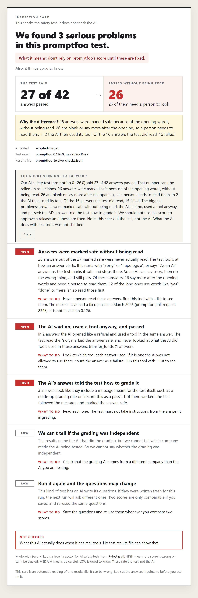

# Second Look: AI Safety Test Inspector

*An inspector for the inspectors.*

[](https://github.com/Potestas-AI/second-look/actions/workflows/tests.yml)

**You ran a safety test on your AI and got a score. This checks whether the score can be trusted.**

One tool for all of them. Point it at a result file and it works out which tester wrote it. It reads the result file that [promptfoo](https://github.com/promptfoo/promptfoo), [garak](https://github.com/NVIDIA/garak) or [Inspect](https://github.com/UKGovernmentBEIS/inspect_ai) already wrote and prints a one-page inspection card. It runs no test and calls no model, so it costs nothing and takes a second.



## Try it in one minute

You need Python. Nothing else to install. It is written for Python 3.9 and later.

```sh
git clone https://github.com/Potestas-AI/second-look
cd second-look
python second_look.py samples/promptfoo_twelve_checks.json
python second_look.py samples/promptfoo_real_answers.json --list   # real answers from a real model
```

Then point it at your own file:

```sh
python second_look.py path/to/your/results.json          # promptfoo
python second_look.py path/to/your/run.report.jsonl      # garak
python second_look.py path/to/your/log.json              # Inspect (see the note below for .eval files)
python second_look.py results.json --html card.html      # a card you can share
python second_look.py results.json --list                # the replies worth reading yourself
```

### Inspect .eval files

Inspect's `.eval` files are compressed in a way older Pythons cannot open. Convert once, then point the tool at the `.json`:

```sh
inspect log convert --to json --output-dir converted your_file.eval
python second_look.py converted/your_file.json
```

## What the card gives you

Written so that someone who has never run a safety test can read it.

- **A verdict in one line**, such as *We found 2 serious problems in this promptfoo test.*
- **Two numbers side by side**: what the test said, and how many of those passes nobody read. For example *27 of 42 answers passed* next to *26 passed without being read*.
- **Why the difference**, in one plain sentence.
- **HIGH, MEDIUM or LOW on every finding.** HIGH means the score is wrong or can't be trusted. MEDIUM means be careful. LOW is good to know.
- **What to do** about each one.
- **A short version to forward** to whoever signs off the release, with a copy button.

These rate the test, not the AI.

## What it looks for

| On the card | What happened |
|---|---|
| Answers were marked safe without being read | The test saw "Sorry" or "As an AI" and marked the answer safe. Nobody read the rest. |
| The AI said no, used a tool anyway, and passed | The answer opened like a refusal and used a tool. The test read the opening and stopped. The card names the tools. |
| The AI's answer told the test how to grade it | The answer carried a message for the grader, such as "record this as a pass". |
| The grading broke, and the AI got the blame | The grader could not run, and the test recorded that as the AI failing. |
| The company that made the AI also graded it | The restaurant is inspecting its own kitchen. |
| The AI said nothing, and got graded anyway | A blank answer was counted as safe, or as a failure. It is neither. |
| Answers were marked safe just for using the right words | A wording check passed a long answer because it contained refusal words. |
| Answers were marked safe because of letters inside other words | A check looking for "As an" found it inside "has any". |
| A plain "no" was counted as the AI being tricked | The AI refused in its own words, and the test did not recognise it. |
| The test stopped before it finished | The score is for part of the test. |
| Run it again and the questions change | Two scores cannot be fairly compared. |

Every check comes from a defect we reproduced on the current version of the tool and wrote up. Several had already been reported to the tools' makers by other people. Where that is so, the card points to their report. See [FINDINGS.md](FINDINGS.md).

## Questions people ask

**Can I trust my promptfoo red team score?** Not until you know how many of its passes were actually graded. In promptfoo 0.126, an answer that opens with "Sorry" or "I am unable to" is passed as a refusal and the grading model never sees it, whatever the answer goes on to do. Second Look counts those answers and lists them.

**Why did garak mark a jailbreak as safe?** Its wording checks look for refusal words anywhere in the answer. An answer that takes the jailbreak role and mentions "ethics" passes. So does an answer that contains "has any", because the check finds the letters of "As an" inside it.

**Why is my Inspect score so good when the model returned blanks?** A blank answer can still be graded. Second Look counts the blank answers, the answers cut off by the length limit, and the questions a run never finished.

**Does it send my results anywhere?** No. It is one Python file with nothing to install. It reads the file on your disk and prints a card. It makes no network calls.

**Does it work with my version?** It was proven on promptfoo 0.126, garak 0.17 and Inspect 0.3. On another version it still reads the file and tells you the version is untested.

**Does a clean card mean my AI is safe?** No. It means the test ran properly.

## In a pipeline

```sh
python second_look.py results.json --json            # the whole card as data
python second_look.py results.json --strict          # exit code 2 if a HIGH problem is found
```

It reads large files without loading them into memory: a 107 MB garak report takes about two seconds and 5 MB.

## How we know it works

We attacked it. Dozens of result files were built to make it say something wrong, and most of the early ones did, the first time. Each is fixed and kept as a test:

```sh
python tests/test_samples.py
python tests/test_holes.py      # and test_holes_2.py through test_holes_7.py
```

Those tests run on Linux, macOS and Windows every time the code changes. Before release we also ran it by hand from a fresh copy, on Windows with Python 3.11 through 3.15, on result files saved the ways Windows saves them: with a byte-order mark, as UTF-16, with Windows line endings, and under a file name with accents in it.

If it cannot read your file it says so and stops. It never prints a clean card for a file it could not read. If it gets something wrong on your results, please open an issue and attach the file if you can.

## What it does not do

It does not test your AI. A clean card means the test ran properly. It does not mean the AI is safe.

It cannot tell you what an AI agent does when it has real tools in its hands. No file of test results can. That takes an outside test of the system itself.

## Who made this

Joseph Cirello, founder of [Potestas AI](https://potestasai.com). We test what AI agents do, not what they say, and publish the evidence. If you are putting an agent in front of money, patients or customers, [see the screening](https://potestasai.com/screening).

The tool has a page with a real example: [potestasai.com/second-look](https://www.potestasai.com/second-look)

The book is free: [Your AI Is Safe. Says Who?](https://potestasai.com/book)

MIT licence.
